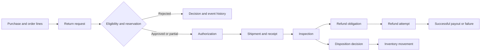

# YotaFlex Returns Engine

A local Python and SQLite project for simulating retail returns and checking
that quantities, refunds, inspections and inventory decisions stay consistent.
The repository includes a reproducible generator, tests, curated negative cases,
a starter example and the complete canonical full exports in one ZIP.

This is a synthetic workflow and data-integrity exercise, not a deployed
commercial returns platform or a connection to a real payment provider.

## Contents

- [Problem and scope](#problem-and-scope)
- [Architecture and lifecycle](#architecture-and-lifecycle)
- [Data model](#data-model)
- [Repository layout](#repository-layout)
- [Setup and quick start](#setup-and-quick-start)
- [Database commands](#database-commands)
- [Generate and validate data](#generate-and-validate-data)
- [Exports and reproducibility](#exports-and-reproducibility)
- [Negative scenarios and ground truth](#negative-scenarios-and-ground-truth)
- [Tests, analytics and evidence](#tests-analytics-and-evidence)
- [Limitations](#limitations)
- [AI assistance](#ai-assistance)
- [Reviewer checklist](#reviewer-checklist)

## Problem and scope

A return is a sequence of related decisions: whether the request is eligible,
how many units remain returnable, what reached the warehouse, what inspection
established, how much can be refunded and where the goods should go. Individually
valid records can still contradict an earlier approval or payment.

The engine creates synthetic customers and transactions, applies explicit
business rules and checks the persisted result. Policies and distributions are
configurable project assumptions, not official retail policies. A fixed seed and
simulation clock make the data reproducible.

Implemented scope includes category/window eligibility, cumulative reservations,
precise refund entitlement, duplicate-payment guards, inspection-backed disposition,
separate movement records, events, validation and CSV/JSON/SQL exports.

**Baseline validation** checks generated data for consistency. **Adversarial
testing** attempts prohibited operations through the existing guards. Guard
enforcement is not an independently evaluated anomaly detector.

## Architecture and lifecycle

| Technology or component | Purpose |
| --- | --- |
| Python 3.11+ standard library | CLI, generator, rules, exact money, validation and exports |
| SQLite 3.37+ with JSON functions | Relational data, constraints, events and transactions |
| `config/default.json` | Seed, scale, policy assumptions and synthetic distributions |
| `unittest` | Temporary-fixture tests for rules, guards, exports and reproduction |
| CSV, JSON and SQL | Portable table data, schema, seed and measured reports |



Missing shipments and pending work remain incomplete states. Requested,
authorized, received, inspected and refunded quantities are distinct. A
`RefundObligation` describes entitlement; a `Refund` records an attempt; only
a success records a payout. An accepted `InventoryDisposition` is a routing
decision, while `InventoryMovement` records execution. Neither is a warehouse
stock-on-hand balance.

See [architecture](docs/project/architecture.md) and
[business rules](docs/project/business_rules.md).

## Data model

| Entities | Role |
| --- | --- |
| `Customer`, `Order`, `OrderLine` | Original customer, purchase and purchased units |
| `ReturnRequest`, `ReturnLine` | Request and its original-order-line references |
| `ReturnAuthorization`, `AuthorizationLine` | Decision and reserved quantities |
| `ReturnShipment`, `ShipmentLine`, `Inspection` | Allocation, receipt and physical condition |
| `RefundObligation`, `Refund` | Entitlement and separate payment attempts |
| `InventoryDisposition`, `InventoryMovement` | Routing decision and recorded execution |
| `Product`, `ReturnPolicy`, `ActionAttempt`, `EventLog` | Catalog, policy, attempts and traceable events |

Exact identifier examples are `ORD-2026-000001`, `RMA-2026-000001`,
`RMAL-RMA-2026-000001-01`, `RTS-2026-000001` and `REF-2026-000001`.
The return-line ID embeds the complete parent RMA. Keys, cardinalities, optional
links and transitions are in the [schema](docs/project/schema.md) and
[unchanged field dictionary](docs/data_dictionary.md).
The generated dictionary's unqualified schema/rules filenames refer to the
corresponding documents under `docs/project/` in this public layout.

## Repository layout

```text
.
├── src/returns_engine/       # Application, schema, generator, CLI and checks
├── tests/                    # Existing schema, generator, policy and scenario tests
├── scripts/                  # Two supported scenario runners
├── config/default.json       # Reproducible synthetic configuration
├── docs/
│   ├── project/              # Design, phase summaries, requirements and analytics
│   ├── evidence/public/      # Selected evidence and final verification
│   ├── ai_prompt_history.md  # Single readable, edited public prompt record
│   └── ai_usage_disclosure.md
├── examples/starter/         # Hash-checked starter CSV/JSON/SQL export example
├── artifacts/full/           # One complete full export ZIP and compact evidence
├── PROJECT_SPEC.md
└── pyproject.toml
```

Raw local histories, duplicate datasets, caches, private logs and SQLite databases
are deliberately excluded. Generated `outputs/` directories are Git-ignored and
are created locally when you run the commands.

## Setup and quick start

Open the project folder in VS Code, then **Terminal → New Terminal → PowerShell**.
Install Python 3.11 or newer with SQLite/JSON support. There are no extra runtime
packages to install; source execution uses `PYTHONPATH`.

```powershell
$python = 'python'
& $python --version
$env:PYTHONPATH = (Join-Path (Get-Location) 'src')
& $python -m unittest discover -s tests -v
```

If Python is not on PATH, set `$python` to your installed interpreter's full path.
Keep `&` before `$python`, which invokes the path stored in the PowerShell
variable. Set the variables again in a new terminal.

Run all following commands from the repository root. Choose fresh destination
names: an existing output directory will not be overwritten. A failed scenario
run may leave a partial new directory; use another fresh name to retry.

## Database commands

```powershell
New-Item -ItemType Directory -Force tmp | Out-Null
& $python -m returns_engine init-db --database tmp/reviewer_empty.db
& $python -m returns_engine inspect-db --database tmp/reviewer_empty.db
```

This initializes a schema for inspection. Dataset generation creates its own
database. Project connections enable foreign keys.

## Generate and validate data

Starter mode uses the full pipeline at 300 orders, 50 requests and 80 return lines:

```powershell
& $python -m returns_engine generate --scale starter --seed 20261022 --config config/default.json --output outputs/reviewer_starter
& $python -m returns_engine validate --input outputs/reviewer_starter
& $python -m returns_engine inspect-db --database outputs/reviewer_starter/returns.db
```

### Full generation — optional and expensive

Full mode creates exactly **30,000 orders, 5,000 requests and 8,000 return lines**,
plus supporting records. One retained run took about 300 seconds and produced
about 547 MB including the database and exports; your environment may differ.
The [complete full exports](artifacts/full/README.md) are included as an
18.1 MB ZIP, so regeneration is not necessary merely to inspect the data.

```powershell
& $python -m returns_engine generate --scale full --seed 20261022 --config config/default.json --output outputs/reviewer_full
& $python -m returns_engine validate --input outputs/reviewer_full
```

The full-generation flags are checked against the current CLI. A new full dataset
was not generated during final publication preparation. Generation stages work
and promotes validated output; an interrupted process can leave a staging folder.

## Exports and reproducibility

```powershell
& $python -m returns_engine export --input outputs/reviewer_starter --output outputs/reviewer_export
& $python -m returns_engine generate --scale starter --seed 20261022 --config config/default.json --output outputs/reviewer_starter_repeat
& $python -m returns_engine reproduce --left outputs/reviewer_starter --right outputs/reviewer_starter_repeat
```

Each generated directory includes `returns.db`, `csv/`, `json/`, `schema.sql`,
`seed.sql`, resolved configuration, source/catalog/customer profiles, calculated
summaries, validation reports, `manifest.json` and `run_metadata.json`.

The [starter example](examples/starter/README.md) and
[full ZIP](artifacts/full/README.md) contain actual CSV/JSON/SQL exports and
manifests, but exclude the SQLite database and private runtime metadata.
They cannot be passed directly to the current validation CLI without a database.
Generate one as above, or use a correctly configured SQL restore. Archive/member
hashes are in [archive_checksums.json](artifacts/full/archive_checksums.json).

Reproduction compares actual deterministic file hashes and logical database
content. SQLite physical bytes, manifest self-hash and volatile runtime metadata
are excluded from canonical hashes. Historical manifests may lack source identity.
The Git attributes preserve stored bytes on checkout so newline conversion does
not invalidate the included export hashes.
Earlier starter preflights differed despite their same nominal seed/configuration;
they are not the final reproduction baseline. See the
[export contract](docs/project/export_contract.md) and
[reproducibility guide](docs/project/reproducibility.md).

## Negative scenarios and ground truth

```powershell
& $python scripts/phase4_scenarios.py outputs/anomalies/reviewer_a
& $python scripts/phase4_scenarios.py outputs/anomalies/reviewer_b
& $python scripts/phase4_validate.py outputs/anomalies/reviewer_a outputs/anomalies/reviewer_b
```

| Prohibited attempt | Legitimate control |
| --- | --- |
| More than remaining returnable quantity | Partially approve the unit still available |
| Successful refund above remaining entitlement | Pay the remaining entitled amount |
| Movement before qualifying inspection | Move goods after finalized sellable inspection |
| Late request without override | Approve on the inclusive deadline |
| Replay a successful logical payment | Succeed once after a failed zero-paid attempt |

Each run creates ten isolated fixture databases and three JSON artifacts:
`ground_truth.json` contains rule-authored expectations, `observations.json`
contains attempted actions and effects, and `scenario_results.json` compares
them. The separate checker validates references, balances, history, integrity and
deterministic reproduction. Selected retained results are linked from
[Phase 4 verification](docs/project/phase4_verification.md).

The curated evidence reports 5/5 prohibited actions blocked and 5/5 controls
producing expected effects, without unauthorized payout or movement. This is
not a meaningful precision, recall, F1 or false-positive estimate.

The original-purchase variants—more than originally purchased and more than
originally paid—were checked separately in Phase 5, but are not labelled persisted
Phase 4 fixtures. The scenarios remain separate from the valid baseline.

## Tests, analytics and evidence

Final technical verification is recorded in the
[submission report](docs/final_submission_report.md), with the exact current
test total, date, exit codes and execution scope. The final run on **29 October
2026** passed **73 tests, with 0 failures, 0 errors and 0 skips**, in a clean
temporary copy of the selected public files. All 19 verification commands
exited 0. The [current log](docs/evidence/public/final_tests.log) and
[command records](docs/evidence/public/commands.json) preserve the measured output
with interpreter/temporary paths redacted. This was not a clone of a public
GitHub repository.

Tests exercise schema/ID/FK constraints, atomic events, eligibility and
reservations, exact money, refunds/idempotency, inspection and movement guards,
generation, exports, reproduction and all five controls. They do not prove every
possible business workflow. Agent-run checks do not establish candidate-independent
review.

The following synthetic full-data findings come from the audited retained
baseline, not real retail performance:

| Measure | Value and denominator |
| --- | --- |
| Core volumes | 30,000 orders; 5,000 return requests; 8,000 return lines |
| Authorization attempts | 6,414 allowed and 1,177 blocked / 7,591 attempts |
| Refund attempts | 4,572 succeeded, 469 failed, 240 requested / 5,281 attempts |
| Inspection condition | 4,081 sellable / 5,454 inspections |
| Exceptions | 261 missing / 4,194 shipments; 600 exchange / 5,000 requests |
| Restock movement | 4,965 units; not a stock-on-hand balance |

Recorded successful payouts total 97,710,112 INR minor units. Direct Phase 5 SQL
checks found 0 overpaid / 4,812 obligations, 0 duplicate success keys / 4,572
distinct successful keys, 0 paid non-success / 709 non-success attempts, and 0
invalid restock / 3,816 restock movement records.

Historical audits checked 400/400 manifest hashes across eight datasets and
50/50 canonical files in the final full/repeat pair. The current package also
rehashes the starter and full archive members. The historical full SQL restore
is inherited evidence; final preparation did not repeat a full restore.
Sources and boundaries: [analytics](docs/project/analytics_summary.md),
[Phase 3 closure](docs/project/phase3_closure.md),
[Phase 5 verification](docs/project/phase5_verification.md) and
[all 92 requirements](docs/project/final_requirements_audit.md).

## Limitations

- No standalone anomaly detector or independently measured detector accuracy.
- No authenticated override workflow; supplied overrides are rejected.
- No external payment/carrier integration; payouts are simulated database records.
- No warehouse stock-on-hand ledger.
- Exchange replacement fulfillment, shipping refunds and a full correction/
  reinspection workflow remain incomplete.
- Some rejected direct SQL actions appear only in scenario observations rather
  than durable application attempt records.
- Cumulative quantity protection depends on using the authorization service.
- No customer-facing UI and no recorded candidate-independent validation of all
  rules. The labelled original-purchase boundary variants remain a scope gap.

The [requirements overview](docs/project/requirements_matrix.md) keeps partial
and inherited evidence visible. This package is not a claim of full production
readiness or complete assessment compliance.

## AI assistance

Codex substantially assisted with planning, implementation, debugging, tests,
validation, analytics and documentation. The single public
[prompt-history file](docs/ai_prompt_history.md) is a readable edited record of
actual requests, not a verbatim transcript. Private originals remain local.
The [AI-use disclosure](docs/ai_usage_disclosure.md) distinguishes agent work
from the candidate's unrecorded independent contributions. No personal work or
successful verification is invented.

## Reviewer checklist

- [ ] Select Python and set `PYTHONPATH` in PowerShell.
- [ ] Run the existing test suite.
- [ ] Generate and validate a fresh starter dataset.
- [ ] Run both scenario sets and their comparison; inspect expectations and effects.
- [ ] Review the starter example, full ZIP, manifest and checksums.
- [ ] Read the limitations, requirement audit, prompt record and disclosure.
- [ ] Confirm the actual publication/submission status in the final report.

The public package's file scope and exclusions are documented in the
[repository audit](docs/project/repository_audit.md). A public repository alone
does not mean the assessment was submitted to the company.
